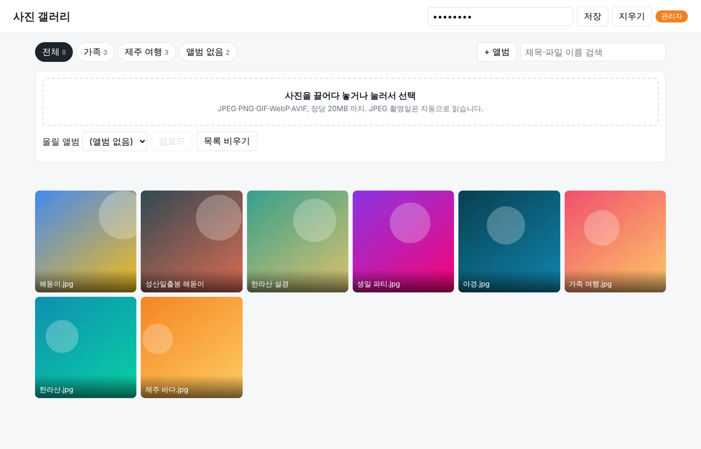
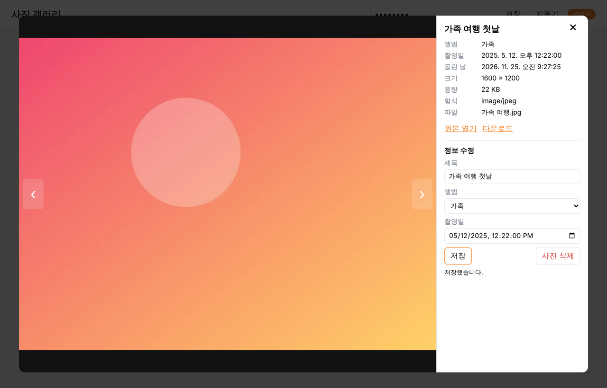

# 02. 사진 갤러리 (Workers 정적 자산 + R2 + D1 + Images)

웹에서 사진을 올리면 앨범별 썸네일 격자로 보여 주고, 사진을 크게 보거나 정보를 수정·삭제할 수 있는 풀스택 앱입니다.
목표는 두 가지입니다.

- **"파일(바이너리)은 R2, 정보는 D1"** 이라는 역할 분리
- **정적 프런트(`public/`)와 API(`src/`)를 Worker 하나로 묶어 배포**하는 방식




## 구조

```
02-photo-gallery/
├── wrangler.jsonc          # Worker 설정 + 바인딩 (assets, R2, D1, Images)
├── migrations/
│   └── 0001_init.sql       # albums, photos 테이블과 인덱스
├── public/                 # 정적 자산 (빌드 없음, Worker 를 거치지 않음)
│   ├── index.html
│   ├── app.js              # 목록, 크게 보기, 업로드, 수정·삭제, 앨범 관리
│   ├── exif.js             # JPEG 촬영일(EXIF) 읽기
│   └── style.css
├── src/
│   ├── index.ts            # Hono 라우터 (/api/*, /img/*)
│   ├── albums.ts           # 앨범 API (D1)
│   ├── photos.ts           # 사진 업로드·목록·수정·삭제 (R2 + D1)
│   ├── images.ts           # 썸네일 생성·R2 저장, 원본 제공
│   └── auth.ts             # 관리자 토큰 확인
├── scripts/smoke-test.mjs  # 업로드 → 목록 → 썸네일 → 수정 → 삭제 자동 확인
└── .dev.vars.example       # 로컬 관리자 토큰 예시
```

## 동작 흐름

```
브라우저 ──► /            ──► public/ 정적 파일 (무료·무제한, Worker 요청 수에 안 잡힘)
         ──► /api/*, /img/* ──► Worker (wrangler.jsonc 의 assets.run_worker_first)

[업로드]  POST /api/photos ──► 바이트로 형식 판별 ──► Images.info() 로 가로·세로
                           ──► R2 put(originals/<id>) ──► D1 INSERT (실패하면 R2 파일을 지워 되돌림)

[썸네일]  GET /img/<id>?w=400
           ① R2 thumbs/400/<id>.webp 있으면 바로 응답                    (X-Thumb: HIT)
           ② 없으면 R2 원본 → Images 로 축소·WebP 변환 → R2 에 저장 후 응답  (X-Thumb: MISS)
           ③ 변환이 실패하면 원본을 그대로 응답                           (X-Thumb: FALLBACK)

[삭제]    DELETE /api/photos/<id> ──► D1 DELETE ──► R2 delete([원본, 썸네일 4종])
```

## API

| 메서드 | 경로 | 설명 |
| --- | --- | --- |
| GET | `/api/albums` | 앨범 목록 + 사진 수, 전체·앨범 없음 사진 수 |
| POST | `/api/albums` | 앨범 만들기. 본문 `{ "name": "제주 여행" }` (관리자) |
| PATCH | `/api/albums/:id` | 이름 바꾸기 (관리자) |
| DELETE | `/api/albums/:id` | 앨범 삭제, 사진은 "앨범 없음"으로 이동 (관리자) |
| GET | `/api/photos?album=&q=&cursor=&limit=` | 목록 (촬영일 최신순). `album` 은 앨범 id 또는 `none` |
| GET | `/api/photos/:id` | 사진 한 장의 정보 |
| POST | `/api/photos` | 업로드. multipart: `file`, `albumId`?, `takenAt`?(Unix 초), `title`? (관리자) |
| PATCH | `/api/photos/:id` | `{ "title"?, "albumId"?, "takenAt"? }` 수정, `null` 은 지우기 (관리자) |
| DELETE | `/api/photos/:id` | 사진 삭제: D1 행 + R2 원본·썸네일 (관리자) |
| GET | `/img/:id?w=400` | 썸네일 WebP. `w` 는 200·400·800·1600 중 하나 |
| GET | `/img/:id/original` | 원본. `?download=1` 이면 원래 파일 이름으로 내려받기 |
| GET | `/api/me` | 관리자 토큰 확인 |

관리자 API 는 헤더 `Authorization: Bearer <ADMIN_TOKEN>` 이 필요합니다.

## 웹 화면 사용법

- 보기는 누구나 할 수 있습니다. 위쪽 탭으로 앨범을 고르고, 검색 칸에 제목이나 파일 이름을 넣습니다. 30장씩 나오며 "더 보기"로 이어서 봅니다.
- 사진을 누르면 크게 보기가 열립니다. 좌우 화살표(키보드 ← → 도 가능)로 넘기고, "원본 열기"·"다운로드"로 원본을 받습니다.
- **관리 기능**: 오른쪽 위 "관리자 토큰" 칸에 `ADMIN_TOKEN` 값을 넣고 저장하면 다음이 나타납니다.
  토큰은 이 브라우저의 localStorage 에만 저장되니 공용 PC 에서는 "지우기"를 누르세요.
  - **업로드**: 사진을 끌어다 놓거나 눌러서 여러 장 고른 뒤, 올릴 앨범을 정하고 "업로드". JPEG 는 촬영일을 자동으로 읽어 목록에 보여 줍니다.
  - **앨범**: "+ 앨범"으로 만들고, 앨범 탭을 고른 상태에서 "이름 바꾸기"·"앨범 삭제". 앨범을 지워도 사진은 "앨범 없음"으로 남습니다.
  - **사진 수정·삭제**: 크게 보기 오른쪽의 "정보 수정"에서 제목·앨범·촬영일을 바꾸거나 "사진 삭제". 삭제는 R2 원본까지 지우므로 되돌릴 수 없습니다.

## 로컬에서 실행하기 (Cloudflare 계정 불필요)

`wrangler dev` 는 R2·D1 을 `.wrangler/state` 폴더에 로컬로 에뮬레이션하고, Images 바인딩은 sharp 라이브러리로 흉내 냅니다.
그래서 `wrangler.jsonc` 의 `database_id` 가 임시값(0000…)이어도 로컬에서는 그대로 동작합니다.

PowerShell 기준입니다.

```powershell
cd D:\04_Study\IT기술\CloudFllare
git pull
cd 02-photo-gallery
npm install                          # 의존성 설치 + wrangler types 로 Env 타입 자동 생성
Copy-Item .dev.vars.example .dev.vars # 로컬 관리자 토큰: local-admin-token
npm run db:migrate:local             # 로컬 D1 에 테이블 생성
npm run dev                          # http://localhost:8787
```

다른 PowerShell 창에서 확인합니다.

```powershell
cd D:\04_Study\IT기술\CloudFllare\02-photo-gallery
npm run smoke                        # 32개 항목 자동 확인, 만든 데이터는 마지막에 지움
```

브라우저에서 `http://localhost:8787` 을 열고 관리자 토큰 칸에 `local-admin-token` 을 넣으면 업로드할 수 있습니다.

로컬 D1·R2 내용을 직접 보려면:

```powershell
npx wrangler d1 execute photo-gallery-db --local --command "SELECT id, title, album_id FROM photos LIMIT 10"
npx wrangler r2 object get photo-gallery/originals/<사진id> --local --file test.jpg
```

로컬 데이터를 초기화하려면 `.wrangler` 폴더를 지우고 `npm run db:migrate:local` 을 다시 실행합니다.

## Cloudflare 에 배포하기 (원할 때만)

1. **R2 활성화**: 대시보드 → R2 Object Storage 에서 R2 를 켭니다. 무료 한도 안에서는 청구되지 않지만 결제 수단 등록이 필요합니다.
2. **리소스 만들기**. Wrangler 가 "설정 파일에 자동으로 추가할까요?" 라고 물으면 `n` 을 누르고, id 는 `wrangler.jsonc` 에 **직접** 붙여 넣습니다.

   ```powershell
   npx wrangler login                          # 최초 1회 (1번 프로젝트에서 했다면 생략)
   npx wrangler r2 bucket create photo-gallery # R2 는 id 없이 이름으로 연결되므로 붙여 넣을 값 없음
   npx wrangler d1 create photo-gallery-db     # 출력된 database_id 를 wrangler.jsonc 의 d1_databases[0].database_id 에 붙여 넣기
   ```

3. **테이블 생성, 관리자 토큰 등록, 배포**

   ```powershell
   npm run db:migrate:remote
   npx wrangler secret put ADMIN_TOKEN         # 원격에서 쓸 토큰 입력 (local-admin-token 과 다르게)
   npm run deploy                              # https://photo-gallery.<계정>.workers.dev
   ```

4. 배포한 주소로 스모크 테스트 (PowerShell 환경 변수 문법)

   ```powershell
   $env:BASE_URL = "https://photo-gallery.<계정>.workers.dev"
   $env:ADMIN_TOKEN = "<입력한 토큰>"
   npm run smoke
   Remove-Item Env:BASE_URL, Env:ADMIN_TOKEN
   ```

Images 바인딩은 따로 켤 것이 없습니다. 대시보드 → Images 에서 이번 달 변환 사용량을 볼 수 있습니다.

## 무료 한도 주의점

| 항목 | 무료 한도 | 이 프로젝트에서의 대응 |
| --- | --- | --- |
| R2 | 저장 10GB, 쓰기(Class A) 월 100만, 읽기(Class B) 월 1,000만, 데이터 전송 무료 | 장당 20MB 제한(`MAX_UPLOAD_MB`), 썸네일은 R2 에 한 번만 저장 |
| Images 변환 | 월 5,000건 (고유 변환 기준). 넘으면 무료 플랜은 새 변환이 실패 | 폭을 4가지로 제한, 결과를 R2 에 저장해 재변환 없음, 실패 시 원본 제공 |
| Workers | 요청 하루 10만, 요청 본문 최대 100MB | 화면(정적 파일)은 Worker 요청에 안 잡힘. 썸네일은 브라우저가 1년 캐시(`immutable`) |
| D1 | 행 읽기 하루 500만, 쓰기 10만. 넘으면 쿼리 실패 | 정렬 순서 그대로 인덱스, OFFSET 대신 커서 페이지 나눔 |

사진 한 장을 올리고 화면에서 보면 대략 Images 변환 2~3건(200·400·1600 폭)이 쓰입니다. 한 달에 1,500장 정도까지는 무료 한도 안입니다.

## 학습 포인트

1. **정적 자산 + Worker 한 번에 배포**: `assets.directory` 로 `public/` 을 올리고, `run_worker_first` 로 `/api/*`, `/img/*` 만 Worker 가 받습니다. 나머지는 Worker 를 거치지 않아 무료·무제한입니다.
2. **R2 와 D1 의 역할 분리**: R2 키를 사진 id 로 정해(`originals/<id>`) D1 행과 연결합니다. 두 저장소는 하나의 트랜잭션으로 묶을 수 없어서, D1 저장이 실패하면 R2 파일을 지우는 **보상 처리**를 합니다(`src/photos.ts`).
3. **Images 바인딩**: `env.IMAGES.input(stream).transform({ width }).output({ format: "image/webp" })`. `info()` 로 가로·세로 크기도 읽습니다.
4. **변환 결과를 R2 에 저장하는 이유**: Cache API 는 `workers.dev` 주소에서 동작하지 않습니다. R2 에 저장하면 주소와 상관없이 사진·크기당 변환이 한 번뿐입니다.
5. **R2 조건부 요청**: `PHOTOS.get(key, { onlyIf: request.headers })` 로 `If-None-Match` 를 R2 가 직접 비교해 304 를 돌려줍니다.
6. **매직 넘버로 형식 판별**: 브라우저가 보낸 Content-Type 대신 파일 앞 바이트로 JPEG·PNG 등을 가립니다.
7. **커서 페이지 나눔**: `(sort_at, id)` 보다 작은 행을 인덱스로 바로 찾아 D1 의 읽은 행 수를 아낍니다.
8. **EXIF 는 브라우저에서**: 촬영일을 서버가 아닌 브라우저(`public/exif.js`)에서 읽어 Worker CPU 시간을 아낍니다.

## 더 해 볼 것

- **사전 서명 URL(presigned URL) 직접 업로드**: 큰 파일은 Worker 를 거치지 않고 브라우저가 R2 S3 API 로 바로 올립니다. R2 API 토큰(Access Key)이 필요하고 로컬 `wrangler dev` 에서는 시험할 수 없어 이번에는 넣지 않았습니다. `aws4fetch` 라이브러리로 서명 URL 을 만들어 보세요.
- **Cloudflare Access 로 가족만 보기**: 대시보드 → Zero Trust → Access 에서 이 Worker 주소에 이메일 OTP 정책을 걸면 코드 수정 없이 보기까지 막을 수 있습니다(50명까지 무료).
- **GitHub 연동 자동 배포(Workers Builds)**: 대시보드에서 저장소를 연결하고 루트 디렉터리를 `02-photo-gallery` 로 지정하면 푸시마다 배포되고 PR 마다 미리보기 URL 이 생깁니다.
- **HEIC(아이폰) 사진**: Images 는 HEIC 입력을 지원하므로, 원본은 그대로 두고 화면에는 항상 변환된 JPEG/WebP 를 보여 주도록 바꿔 보세요.
- **화면 교체**: `public/` 을 React 나 Flutter Web 빌드 결과로 바꿔도 API 는 그대로 씁니다.
