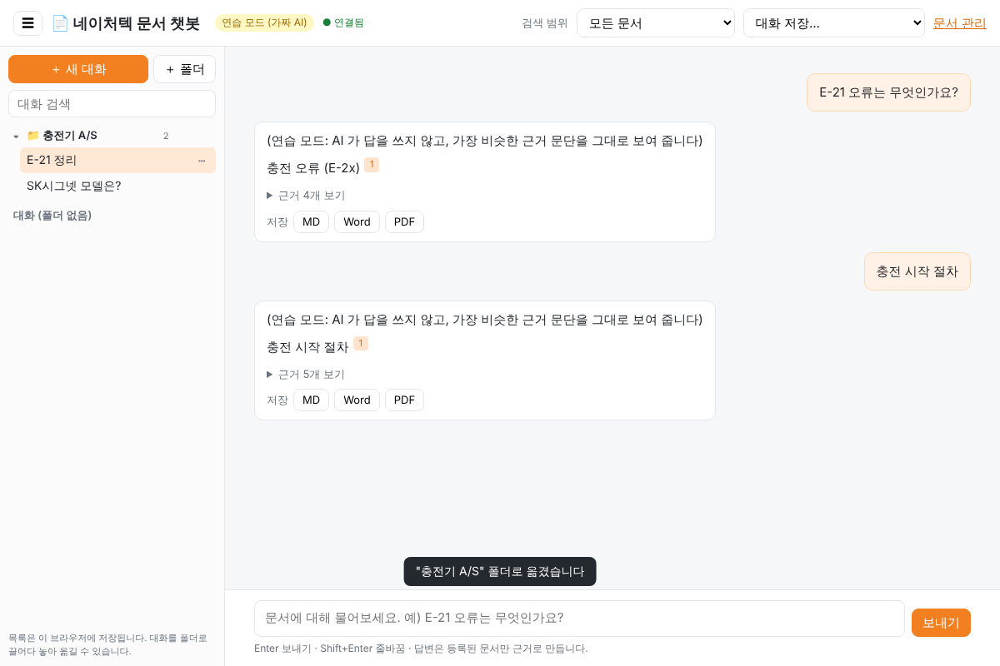
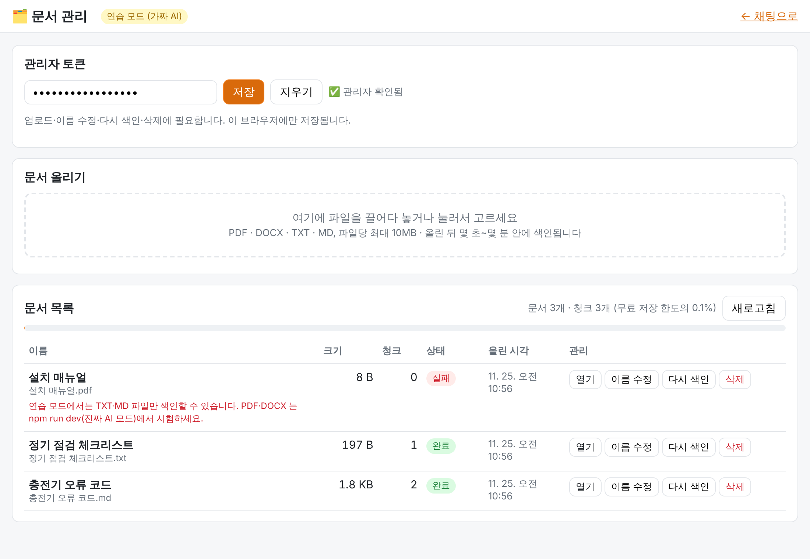

# 03. 네이처텍 문서 챗봇 (Workers AI + Vectorize + Queues + Agents SDK + AI Gateway)

관리자가 PDF·Word·한글(HWPX)·엑셀·이미지 문서(예: 충전기 프로토콜 문서, 오류 코드 표)를 올리면,
누구나 채팅으로 질문하고 **"근거 문서와 함께"** 답을 받는 RAG(검색 증강 생성) 챗봇입니다.
목표는 두 가지입니다.

- **RAG 를 직접 조립**하며 원리 익히기: 청크 분할 → 임베딩 → 벡터 검색 → 근거를 넣은 프롬프트
- **서버리스인데 상태를 기억하는 구조**: Agents SDK(Durable Object)로 브라우저마다 대화 기록 유지




## 구조

```
03-ai-doc-chatbot/
├── wrangler.jsonc            # Worker 설정 + 모든 바인딩, 연습 모드(env.mock)
├── migrations/
│   ├── 0001_init.sql         # documents, chunks, mock_vectors 테이블
│   ├── 0002_settings.sql     # 관리 화면 설정 값
│   └── 0003_conversations.sql # 대화 목록·폴더 (사이드바)
├── public/                   # 정적 화면 (빌드 없음)
│   ├── index.html · app.js   # 채팅 화면 (순수 WebSocket)
│   ├── sidebar.js            # 왼쪽 사이드바: 폴더·대화 목록
│   ├── admin.html · admin.js # 문서 관리 화면 (업로드·목록·열기·이름 수정·다시 색인·삭제)
│   ├── settings.html · settings.js # 설정 화면 (모델·외부 AI 키 상태·검색·색인 값)
│   ├── export.js             # 답변 저장: Markdown · Word(.docx) · PDF(인쇄)
│   ├── common.js · style.css
├── src/
│   ├── index.ts              # 진입점: fetch(화면·API·에이전트 라우팅) + queue(색인)
│   ├── documents.ts          # 문서 API (R2 + D1 + 큐 생산자)
│   ├── indexer.ts            # 큐 소비자: 텍스트 추출 → 청크 → 임베딩 → 저장
│   ├── chunk.ts              # 청크 분할 (약 800자, 겹침 100자)
│   ├── rag.ts                # 검색 + 프롬프트 만들기
│   ├── agent.ts              # ChatAgent (Agents SDK): 대화 기록, 답변 스트리밍, Rate Limiting
│   ├── ai.ts                 # Workers AI · AI Gateway · Vectorize 호출, 연습 모드 가짜 구현
│   ├── conversations.ts      # 대화 목록·폴더 API
│   ├── settings.ts           # 설정(모델·검색·청크) 저장·API
│   ├── providers.ts          # 외부 AI 답변: OpenAI · Anthropic Claude (AI Gateway 경유)
│   ├── hwpx.ts               # 한글 HWPX → Markdown
│   └── auth.ts               # 관리자 토큰, 공용 타입
├── samples/charger-error-codes.md  # 시험용 가상 오류 코드 문서
├── scripts/smoke-test.mjs    # 업로드 → 색인 → 질문 → 수정 → 삭제 자동 확인
└── .dev.vars.example         # 로컬 관리자 토큰 예시
```

## 동작 흐름

```
[업로드]  관리자 화면 ─► POST /api/documents ─► R2 put(docs/<id>.<확장자>) ─► D1 documents(queued)
                                             └─► Queue send({ docId })  ← 응답은 여기서 바로 끝
[색인]    Queue 소비자 ─► R2 get ─► 텍스트 추출 (TXT·MD 그대로, CSV·HWPX 는 직접 변환 / PDF·DOCX·엑셀은 AI.toMarkdown / 이미지는 비전 모델 OCR)
                       ─► 청크 분할 ─► AI.run(bge-m3) 임베딩 ─► Vectorize upsert(id "문서id:순번")
                       ─► D1 chunks 에 원문 저장 ─► documents.status = ready (실패하면 2번 더 시도 후 failed)

[질문]    브라우저 ═WebSocket═► /agents/chat-agent/<세션id> ─► ChatAgent (브라우저마다 하나, 자체 SQLite)
             ① Rate Limiting (IP당 60초 10번)
             ② 질문 임베딩 ─► Vectorize query(topK 5, 선택한 문서만 filter) ─► D1 에서 청크 원문
             ③ [시스템 규칙 + 최근 3턴 + 근거 + 질문] ─► AI.run(LLM, stream) ─► AI Gateway(로그·캐시)
             ④ start → sources → delta… → done 을 WebSocket 으로 보내고, 대화를 SQLite 에 저장
```

**왜 이렇게 나눴나**

| 질문 | 답 |
| --- | --- |
| 원문은 왜 D1 에 따로 두나? | Vectorize 는 "벡터 + 작은 메타데이터" 저장소입니다. 답변에 넣을 원문은 같은 id 로 D1 에서 꺼냅니다. |
| 색인은 왜 큐로? | PDF 변환·임베딩은 수 초~수십 초 걸립니다. 업로드 응답을 기다리게 하지 않고, 실패하면 큐가 자동으로 다시 시도합니다. |
| 대화 기록은 왜 Durable Object 에? | 한 사람의 대화는 "한 곳에서 순서대로" 처리되어야 합니다. Agent 인스턴스는 이름마다 하나라서 동시 요청이 꼬이지 않고, 자체 SQLite 에 기록이 남습니다. |
| 왜 React(useAgentChat)를 안 쓰나? | 1·2번처럼 빌드 없이 만들기 위해서입니다. `AIChatAgent`(@cloudflare/ai-chat)는 Vercel AI SDK·React 클라이언트를 전제로 하므로, 기본 `Agent` 클래스에 간단한 WebSocket 메시지 형식을 직접 정했습니다(`src/agent.ts` 맨 위 주석). |

## API

| 메서드 | 경로 | 설명 |
| --- | --- | --- |
| GET | `/api/me` | 관리자 여부, 연습 모드 여부, 화면 제목, 모델 이름 |
| GET | `/api/conversations` | 내 폴더·대화 목록 (헤더 `X-Client-Id`) |
| POST · PATCH · DELETE | `/api/conversations/folders[/:id]` | 폴더 만들기·이름 바꾸기·삭제(`?withConversations=1` 이면 대화도 삭제) |
| POST · PATCH · DELETE | `/api/conversations[/:id]` | 대화 등록·제목/폴더 바꾸기·삭제(기록도 지움) |
| GET · PUT · DELETE | `/api/settings` | 설정 읽기(외부 AI 키 유무 포함) · 일부 바꾸기 · 모두 기본값으로 (관리자) |
| POST | `/api/settings/test` | 모델 시험. 본문 `{ "model": "@cf/..." }` (관리자) |
| GET | `/api/documents` | 문서 목록 + 전체 청크 수 |
| POST | `/api/documents` | 업로드 (multipart `file`, 선택 `name`). PDF·DOCX·HWPX·XLSX·XLSM·XLS·CSV·TXT·MD 10MB, JPG·PNG·WebP 4MB 까지 (관리자) |
| GET | `/api/documents/:id/file` | 원본 열기, `?download=1` 이면 내려받기 |
| PATCH | `/api/documents/:id` | 이름 수정. 본문 `{ "name": "..." }` (관리자) |
| POST | `/api/documents/:id/reindex` | 다시 색인 (관리자) |
| DELETE | `/api/documents/:id` | 삭제: R2 원본, D1 행·청크, Vectorize 벡터 모두 (관리자) |
| DELETE | `/api/documents?confirm=all` | 모두 삭제. 관리 화면의 "모두 삭제" 버튼은 `모두 삭제` 라고 입력해야 실행됩니다 (관리자) |
| WS | `/agents/chat-agent/:대화id` | 채팅. 메시지 형식은 `src/agent.ts` 참고 |

관리자 API 는 헤더 `Authorization: Bearer <ADMIN_TOKEN>` 이 필요합니다. 질문과 원본 열기는 누구나 할 수 있습니다.
사내에서만 쓰게 하려면 [Cloudflare Access](https://developers.cloudflare.com/cloudflare-one/policies/access/)(Zero Trust, 50명까지 무료)를 Worker 앞에 두세요.

## 실행 방법 1: 연습 모드 (로그인 불필요)

Workers AI 와 Vectorize 는 로컬 흉내가 없어서 `wrangler dev` 에서도 실제 Cloudflare 리소스를 씁니다.
그래서 먼저 **AI 없이 화면과 흐름을 확인하는 연습 모드**를 둡니다(`wrangler.jsonc` 의 `env.mock`).
가짜 임베딩(글자 조각 해시)과 D1 안의 단순 검색, "가장 비슷한 근거 문단을 그대로 보여 주는" 가짜 답변을 씁니다. TXT·MD·CSV·HWPX 만 색인됩니다(AI 가 필요 없는 형식). 연습 모드는 답을 "쓰지" 않습니다. 질문 단어가 들어 있는 조각을 앞으로 올려 가장 비슷한 문단(표이면 맞는 행만)을 그대로 보여 줄 뿐이라, "SK시그넷 모델은?"처럼 문서에 있는 단어로 물어야 잘 찾습니다.

```powershell
cd D:\04_Study\IT기술\CloudFlare\CloudFlareStudy\03-ai-doc-chatbot
npm install                              # 의존성 설치 + wrangler types 로 Env 타입 생성
Copy-Item .dev.vars.example .dev.vars    # 로컬 관리자 토큰 (값을 바꿔도 됨)
npm run db:migrate:mock                  # 로컬 D1 에 테이블 생성
npm run dev:mock                         # http://localhost:8787
```

1. http://localhost:8787/admin.html 에서 관리자 토큰(`local-admin-token`)을 저장하고 `samples/charger-error-codes.md` 를 끌어다 놓습니다.
2. 상태가 "완료"가 되면 http://localhost:8787 에서 "E-21 오류는 무엇인가요?" 라고 물어봅니다.
3. 다른 PowerShell 창에서 `npm run smoke` 로 전체 흐름을 자동 확인할 수 있습니다.

## 실행 방법 2: 진짜 AI 모드

### 1) Cloudflare 리소스 만들기 (한 번만)

```powershell
npx wrangler login
npx wrangler r2 bucket create doc-chatbot-files
npx wrangler d1 create doc-chatbot-db
npx wrangler vectorize create doc-chatbot-index --dimensions=1024 --metric=cosine
npx wrangler vectorize create-metadata-index doc-chatbot-index --propertyName=docId --type=string
npx wrangler queues create doc-chatbot-index-jobs
```

- `d1 create` 가 출력한 `database_id` 를 `wrangler.jsonc` 의 **맨 위 `d1_databases`** 에 직접 붙여 넣습니다.
  (Wrangler 가 설정 파일을 자동으로 고치겠냐고 물으면 "아니오"를 고르세요. 같은 값을 `env.mock` 쪽에 넣을 필요는 없습니다.)
- Vectorize 인덱스의 차원(1024)은 임베딩 모델 bge-m3 의 출력 크기와 같아야 합니다. 메타데이터 인덱스(`docId`)는 **벡터를 넣기 전에** 만들어야 "문서 골라 질문하기" 필터가 동작합니다.
- **AI Gateway**: 대시보드 → AI → AI Gateway → 만들기에서 이름을 `doc-chatbot` 으로 만듭니다.
  쓰지 않으려면 `wrangler.jsonc` 의 `AI_GATEWAY_ID` 를 `""` 로 비우세요.

### 2) 로컬에서 실행

```powershell
npm run db:migrate:local
npm run dev                              # AI·Vectorize 는 원격(실제 계정), 나머지는 로컬
```

- 시작할 때 "여러 환경이 있으니 --env 를 지정하라"는 경고가 나와도 맨 위(기본) 설정이 쓰이니 괜찮습니다.
- 로컬에서 올린 문서도 **실제 Vectorize 인덱스**에 벡터가 들어갑니다. 대신 `.dev.vars` 의 `VECTOR_NAMESPACE=dev` 덕분에 벡터 id 와 검색 범위가 배포본(`prod`)과 나뉘어, 로컬 시험이 배포본 벡터를 덮어쓰거나 지우지 않습니다. 저장 한도는 함께 쓰므로 시험이 끝나면 화면에서 문서를 삭제해 정리하세요.
- Vectorize 는 최종 일관성이라 색인 직후 몇 초 동안은 검색에 안 잡힐 수 있습니다.

### 3) 배포 (직접 할 때만)

```powershell
npx wrangler secret put ADMIN_TOKEN      # 배포용 관리자 토큰
npm run db:migrate:remote                # 새 마이그레이션(예: 0002_settings, 0003_conversations)이 생기면 배포 전에 꼭 다시 실행
npm run deploy                           # https://doc-chatbot.<계정>.workers.dev
```

번들 크기는 약 2.4MB(gzip 460KB)로 무료 플랜 Worker 크기 한도(압축 3MB) 안입니다.

## 대화 목록과 폴더 (왼쪽 사이드바)

ChatGPT·Claude 대화창처럼 왼쪽에 대화 목록이 있습니다.

- **＋ 새 대화**: 빈 대화를 시작합니다. 첫 질문을 보내면 목록에 생기고, 제목은 첫 질문입니다.
- **＋ 폴더**: 폴더를 만듭니다. 폴더 줄의 **＋** 를 누르면 그 폴더 안에서 새 대화를 시작합니다.
- 대화를 누르면 그 대화의 기록이 열리고, 이어서 질문할 수 있습니다(대화마다 ChatAgent 인스턴스가 하나씩).
- 대화의 **⋯** 메뉴: 이름 바꾸기 · 폴더로 옮기기 · 삭제. 대화를 폴더로 **끌어다 놓아도** 옮겨집니다.
- 폴더의 **⋯** 메뉴: 이름 바꾸기 · 폴더만 삭제(대화는 "폴더 없음"으로) · 폴더와 대화 모두 삭제.
- 목록은 D1(`folders`, `conversations`)에 저장되지만, 로그인이 없어서 **브라우저마다 따로**입니다(localStorage 의 무작위 id 를 `X-Client-Id` 로 보냄). 다른 PC·브라우저에서는 보이지 않습니다. 사람별로 묶으려면 Cloudflare Access 를 앞에 두고 로그인 이메일을 owner 로 쓰도록 바꾸면 됩니다.
- 폴더 기능 전에 쓰던 대화가 있으면 처음 열 때 "이전 대화"로 목록에 들어갑니다.

## 설정 화면 (`/settings.html`)

채팅 화면 위쪽 ⚙️ 또는 문서 관리 화면의 **⚙️ 설정** 링크로 들어가는 별도 화면(관리자 토큰 필요)에서 다시 배포하지 않고 바꿀 수 있습니다. 값은 D1 `settings` 표에 저장되고, 저장하지 않은 항목은 아래 `vars` 가 기본값입니다.

| 묶음 | 항목 |
| --- | --- |
| 화면 | 화면 제목 (기본 "네이처텍 문서 챗봇") |
| 외부 AI 연결 | OpenAI · Claude API 키가 들어 있는지(✅/❌), AI Gateway 사용 여부, 키 넣는 방법 |
| 답변 AI 모델 | 답변 모델(Workers AI · Claude · OpenAI 중에서 고르기 또는 직접 입력) · **[선택한 모델 시험]** 버튼 · 생각(reasoning) 모드 · 온도 · 답변 길이 상한 · 시스템 프롬프트 |
| 검색 | 근거 조각 수(topK) · 관련도 기준(minScore) |
| 색인 | 이미지 OCR 모델 · 조각 크기 · 조각 겹침 · 문서당 조각 수 한도 |

- 모델 목록은 2026-11 기준 무료 플랜에서 쓸 수 있고 [지원 종료 예정](https://developers.cloudflare.com/changelog/post/2026-11-05-planned-model-deprecations/)이 아닌 모델입니다. 모델은 자주 바뀌므로 바꾸기 전에 **[선택한 모델 시험]** 으로 이 계정에서 실제로 되는지 확인하세요.
- 색인 항목(OCR 모델·조각 크기)은 새로 올리거나 "다시 색인"하는 문서부터 적용됩니다.
- 임베딩 모델은 Vectorize 인덱스 차원(1024)과 맞아야 해서 화면에서 바꾸지 않습니다.

### OpenAI · Claude 로 답변하기

답변 모델 목록에 `anthropic/claude-opus-5-5` · `claude-sonnet-5-5` · `claude-haiku-5-5`, `openai/gpt-6.2-sol` · `gpt-6.1-terra` · `gpt-6-luna` 가 있습니다(목록에 없는 모델은 `openai/모델` · `anthropic/모델` 형식으로 직접 입력). 검색(임베딩)과 OCR 은 계속 Workers AI 를 씁니다.

API 키는 **화면에서 입력하지 않고 Worker 비밀 값**으로 넣습니다. 화면·D1 에 키를 두면 관리자 토큰 하나가 새어 나갔을 때 키까지 드러나기 때문입니다. 설정 화면에는 키가 들어 있는지만 보입니다.

```powershell
# 로컬(npm run dev · dev:mock): .dev.vars 에 추가하고 다시 실행
#   OPENAI_API_KEY=sk-...
#   ANTHROPIC_API_KEY=sk-ant-...
# 배포본: 명령을 실행하고 키를 붙여 넣기 (다시 배포할 필요 없음)
npx wrangler secret put OPENAI_API_KEY
npx wrangler secret put ANTHROPIC_API_KEY
```

- `AI_GATEWAY_ID` 가 있으면 `env.AI.gateway(id).getUrl("openai" | "anthropic")` 주소로 호출해 AI Gateway 대시보드에 로그·비용이 함께 남습니다. 게이트웨이에 인증(Authenticated Gateway)을 켰다면 `CF_AIG_TOKEN` 비밀 값도 넣으세요.
- 키를 Worker 에 두지 않으려면 AI Gateway 의 **Provider Keys(BYOK)** 에 키를 저장하는 방법도 있습니다(이 프로젝트는 Worker 비밀 값 방식을 기본으로 씁니다).
- Claude 는 공식 SDK(`@anthropic-ai/sdk`)로 부르고, 생각 모드 설정은 생각 깊이(`effort` 낮음/보통)로 적용합니다. 최신 Claude·GPT 는 온도(temperature)를 받지 않아 온도 설정은 Workers AI 모델에만 쓰입니다. 생각 토큰도 답변 한도에 들어가므로 외부 AI 는 답변 길이 상한을 최소 4096 으로 씁니다.
- Claude 는 정책상 답을 거절하면 Anthropic 이 정한 다른 모델로 한 번 더 시도합니다(`fallbacks: "default"`).
- ⚠️ 외부 AI 를 고르면 **질문과 검색된 사내 문서 조각이 OpenAI · Anthropic 서버로 보내지고**, 사용한 만큼 그 회사에 요금이 나갑니다. 사내 보안 규정을 먼저 확인하세요.
- 연습 모드(`dev:mock`)에서도 키가 있으면 설정 화면의 **[선택한 모델 시험]** 으로 키가 맞는지 확인할 수 있습니다(채팅 답변은 연습 모드에서는 계속 가짜 답).

## 답변 모드와 웹 검색 (질문창 왼쪽)

| 모드 | 동작 |
| --- | --- |
| 📄 문서만 (기본) | 등록 문서에서 찾은 근거로만 답합니다. 없으면 "등록된 문서에서 찾지 못했습니다." |
| 📄+💡 문서 우선 + 일반 지식 | 근거가 있으면 근거 번호와 함께 먼저 쓰고, 없거나 부족한 부분은 일반 지식으로 보충합니다. 그 문단은 "※ 등록 문서에 없는 일반 정보입니다."로 시작하고 화면에서 파란 띠로 표시됩니다. |
| 💡 일반 질문 | 문서 검색 없이 일반 지식으로 답합니다(검색 범위 선택은 꺼짐). |

- 고른 모드와 🌐 웹 검색 켬/끔은 이 브라우저에 기억됩니다.
- 모드 규칙(`src/rag.ts` 의 `MODE_RULES`)은 시스템 프롬프트 **뒤에 자동으로 붙습니다**. 설정 화면에서 프롬프트를 직접 고쳐도 모드는 그대로 동작하고, 둘이 다르면 모드 규칙을 따릅니다. 설정 화면의 **[기본값 불러오기]** 로 기본 프롬프트를 칸에 채워 고칠 수 있습니다.
- **🌐 웹 검색**은 답변 모델이 Claude·OpenAI 일 때만 됩니다. 각 회사의 자체 웹 검색 도구(Claude `web_search` 서버 도구, OpenAI Responses API `web_search`)를 쓰고, 웹에서 가져온 내용에는 🌐 와 출처 링크가 붙으며 답 끝에 "웹 출처" 목록이 붙습니다. 질문 하나에 검색은 최대 3번이고, 검색마다 해당 회사에 요금이 나갑니다.
  - Claude 는 Anthropic 콘솔의 조직 설정에서 웹 검색이 켜져 있어야 합니다.
  - Workers AI 모델에는 웹 검색 도구가 없어 체크 상자가 꺼져 있습니다(마우스를 올리면 이유가 보임). Workers AI 로도 하려면 Tavily·Brave 같은 검색 API(별도 키)를 붙이는 방법이 있습니다(지금은 구현하지 않음).
  - 설정 화면의 "질문창의 🌐 웹 검색 허용"을 끄면 모두 꺼집니다.

## 답변 저장 (Markdown · Word · PDF)

채팅 화면에서 답변마다 **저장 MD · Word · PDF** 버튼이 있고, 위쪽 **대화 저장…** 에서 지금까지의 대화 전체를 저장할 수 있습니다. 질문, 답변(표·목록 포함), 근거 문서 목록이 함께 들어갑니다. 서버를 거치지 않고 브라우저에서 바로 만듭니다(`public/export.js`).

- **Word(.docx)**: 라이브러리 없이 ZIP 안에 Word XML 을 직접 넣어 만듭니다. 제목·표·목록·굵게가 Word 서식으로 들어가고 글꼴은 맑은 고딕입니다.
- **PDF**: 한글 글꼴을 PDF 에 넣으려면 큰 글꼴 파일이 필요해서, 인쇄용 화면을 만들어 브라우저 인쇄 창을 엽니다. 대상(프린터)을 **"PDF로 저장"** 으로 고르세요.
- HWPX 로 저장은 아직 없습니다. Word 파일을 한글에서 열어 HWPX 로 저장하면 됩니다.

## 모델과 설정값 (`wrangler.jsonc` 의 `vars`)

아래 값은 설정 화면의 **기본값**입니다(화면에서 저장한 값이 있으면 그 값이 우선).

| 이름 | 기본값 | 설명 |
| --- | --- | --- |
| `CHAT_MODEL` | `@cf/google/gemma-4-26b-a4b-it` | 답변 모델. Cloudflare 가 [무료 플랜에서 쓸 수 있다고 밝힌](https://developers.cloudflare.com/changelog/post/2026-07-28-models-require-workers-paid/) 모델입니다. 로컬에서는 `.dev.vars` 에 `CHAT_MODEL=...` 을 넣어 바꿔 볼 수 있습니다. |
| `EMBED_MODEL` | `@cf/baai/bge-m3` | 다국어 임베딩(1024차원). 바꾸면 Vectorize 인덱스를 그 차원으로 다시 만들고 모든 문서를 다시 색인해야 합니다. |
| `VECTOR_NAMESPACE` | `prod` (로컬은 `.dev.vars` 의 `dev`) | 같은 Vectorize 인덱스를 로컬과 배포본이 나눠 쓰기 위한 [네임스페이스](https://developers.cloudflare.com/vectorize/reference/metadata-filtering/#namespace-versus-metadata-filtering) |
| `AI_GATEWAY_ID` | `doc-chatbot` | AI Gateway 이름. 비우면 게이트웨이 없이 호출 |
| `OCR_MODEL` | `@cf/google/gemma-4-26b-a4b-it` | 이미지 글자 읽기(OCR)용 비전 모델 |
| `MAX_UPLOAD_MB` | `10` | 업로드 크기 한도 |
| `MAX_IMAGE_MB` | `4` | 이미지 업로드 크기 한도 (base64 로 모델에 보내므로 작게) |
| `MAX_CHUNKS_PER_DOC` | `400` | 문서 하나의 청크 한도 (Vectorize 무료 한도 보호) |

모델은 자주 바뀝니다. 답변이 `5018`(이 계정은 모델 사용 불가), `5028`(지원 종료), `5035`(유료 플랜 필요) 오류로 실패하면
[모델 목록](https://developers.cloudflare.com/workers-ai/models/)과 [지원 종료 공지](https://developers.cloudflare.com/changelog/product/workers-ai/)를 보고 설정 화면에서 답변 모델을 바꾸세요.
채팅 화면에도 이 안내가 함께 표시됩니다.

검색 개수(topK), 관련도 기준(minScore), 시스템 프롬프트, 청크 크기는 설정 화면에서 바꿉니다(기본 규칙 프롬프트는 `src/rag.ts`).
진짜 모드로 처음 써 볼 때는 관련도 기준(0.35)이 너무 높거나 낮지 않은지, 화면의 근거 "유사도" 값을 보며 맞춰 보세요.

검색은 **하이브리드**입니다. 벡터 검색(뜻이 비슷한 조각)에 더해, 질문 단어가 글자 그대로 들어 있는 조각을 D1 에서 찾아(`instr`) 후보에 넣고, 단어가 들어 있는 비율만큼 점수를 더해 다시 줄을 세웁니다. "SK시그넷"처럼 회사명·모델명·코드만 물으면 큰 표 조각과의 벡터 유사도가 기준(0.35)보다 낮게 나와 근거가 0개가 되고 "등록된 문서에서 찾지 못했습니다"가 나오기 쉬운데, 키워드 쪽이 이것을 잡아 줍니다. `npm run dev` 터미널에 `검색: 문서이름#조각(점수, 키워드)` 로그가 찍히니, 답이 이상하면 어떤 근거가 뽑혔는지 먼저 보세요.

## 무료 한도 주의점 (2026-11-25 공식 문서 기준)

| 서비스 | 무료 한도 | 이 프로젝트에서 |
| --- | --- | --- |
| [Workers AI](https://developers.cloudflare.com/workers-ai/platform/pricing/) | 하루 10,000 Neurons (00:00 UTC = 한국 오전 9시 초기화) | 대부분 LLM 답변이 씁니다. `max_tokens` 1024 로 답변 길이를 제한했습니다. 한도를 넘으면 다음 날까지 AI 호출이 실패합니다. |
| [Vectorize](https://developers.cloudflare.com/vectorize/platform/pricing/) | 저장 500만 차원, 쿼리 월 3,000만 차원 | 1024차원 → 저장 약 4,882개 청크, 질문 월 약 2만 9천 번. 관리 화면 막대가 저장 사용량입니다. |
| [Queues](https://developers.cloudflare.com/queues/platform/pricing/) | 하루 10,000 작업, 보관 24시간 | 메시지 1건 ≈ 3작업 → 하루 약 3,300건 색인 |
| [Durable Objects](https://developers.cloudflare.com/durable-objects/platform/pricing/) | 요청 10만/일, SQLite 저장소만 | `new_sqlite_classes` 로 선언 (무료 플랜 조건) |
| [D1](https://developers.cloudflare.com/d1/platform/pricing/) | 행 읽기 500만/일, 쓰기 10만/일 | 넘으면 쿼리가 실패합니다. 청크 조회는 기본 키, 목록은 인덱스를 씁니다. |
| [AI Gateway](https://developers.cloudflare.com/ai-gateway/reference/pricing/) | 핵심 기능 무료 | 2026-09-24 이후 처음 만든 게이트웨이는 로그가 Workers Logs(무료 하루 20만 건, 3일 보관)로 저장됩니다. |
| [Rate Limiting](https://developers.cloudflare.com/workers/runtime-apis/bindings/rate-limit/) | 별도 과금 표기 없음 | 기간은 10초나 60초만 가능, 데이터센터별 근사치 제한입니다. |

- 무료 플랜 Worker 는 호출당 CPU 10ms 제한이 있지만, AI·DB 응답을 **기다리는 시간은 포함되지 않습니다.** 아주 큰 문서의 청크 분할은 CPU 를 쓰므로, 수백 쪽 문서는 나눠 올리는 편이 안전합니다.
- 엑셀은 `toMarkdown` 이 시트를 Markdown 표로 바꾸고, 큰 표는 행 단위로 잘라 조각마다 머리글 행을 다시 붙입니다(`src/chunk.ts`). 그래서 첫 행에 열 이름이 있는 시트가 검색이 잘 됩니다. 차트·이미지 같은 표 밖의 내용은 색인되지 않을 수 있습니다. CSV 는 AI 없이 직접 표로 바꾸고, 엑셀에서 저장한 한국어 CSV(CP949)도 읽습니다.
- **한글(HWPX)** 은 ZIP 안의 XML(`Contents/section*.xml`)을 직접 읽어 문단은 글로, 표는 Markdown 표로 바꿉니다(`src/hwpx.ts`, AI 불필요라 연습 모드에서도 됩니다). 공문서 표 모양도 정리합니다: 칸 하나짜리 제목 상자와 맨 위·아래의 가로 전체 병합 행(표 제목, ※ 비고)은 글로 빼고, 두 줄로 병합된 머리글은 열마다 합치며("충전기 모델명"), 세로로 병합된 칸(같은 제조사의 여러 모델)은 행마다 다시 적습니다. 예전 형식 **HWP 는 지원하지 않으니** 한글에서 [다른 이름으로 저장] → HWPX(또는 PDF)로 저장해 올리세요. 암호를 걸었거나 배포용으로 저장한 문서는 읽을 수 없습니다. 그림 속 글자는 색인되지 않습니다.
- **이미지(JPG·PNG·WebP)** 는 비전 모델에 "보이는 글자를 그대로 옮겨 적어라(표는 Markdown 표로)"라고 요청해 얻은 글을 색인합니다(`src/ai.ts` 의 `ocrImage`). 스캔한 매뉴얼 페이지, 화면 캡처, 오류 코드표 사진에 쓸 수 있습니다. 모델이 읽는 것이라 틀린 글자가 있을 수 있으니, 중요한 문서는 관리 화면의 "열기"로 원본과 비교해 보세요. 이미지 한 장의 OCR 은 Neurons 를 꽤 쓰므로 무료 한도를 생각해 필요한 이미지만 올리세요. 연습 모드에서는 비전 모델이 없어 "실패"로 표시됩니다.
- [지원 형식](https://developers.cloudflare.com/workers-ai/features/markdown-conversion/supported-formats/)의 다른 형식(ODT, ODS, HTML 등)도 `SUPPORTED_EXT` 와 `CONTENT_TYPES` 에 추가하면 쓸 수 있습니다.
- 문서 변환(`toMarkdown`)은 현재 베타입니다. 스캔 이미지로 된 PDF 는 텍스트가 없어 "텍스트를 찾지 못했습니다"로 실패합니다.

## AI Search 로 바꾸면?

[AI Search](https://developers.cloudflare.com/ai-search/)(구 AutoRAG)는 이 프로젝트의 `indexer.ts`·`rag.ts`·Vectorize·Queues 가 하는 일(R2 감시 → 변환 → 청크 → 임베딩 → 검색)을 통째로 관리해 주는 서비스입니다.
R2 에 파일을 올리기만 하면 되고, 검색은 바인딩 호출 한 번이면 됩니다. 2026-10-01 GA 가 되었고 **2026-12-01 부터 사용량 과금**(무료: 월 시맨틱 쿼리 1,000회, 저장 10GB)이 시작됩니다.
원리를 익힌 뒤 운영용으로는 AI Search 를 검토해 보세요.

## 더 해 볼 것

- 검색을 에이전트의 "도구(tool)"로 바꿔 LLM 이 필요할 때만 검색하게 하기 (에이전트형 RAG)
- AI Gateway 에서 Claude·OpenAI 같은 외부 모델로 바꿔 답변 품질 비교하기
- 하이브리드 검색 고도화: 지금의 단순 글자 검색(`instr`) 대신 D1 FTS5 전문 검색과 점수(BM25)를 쓰기
